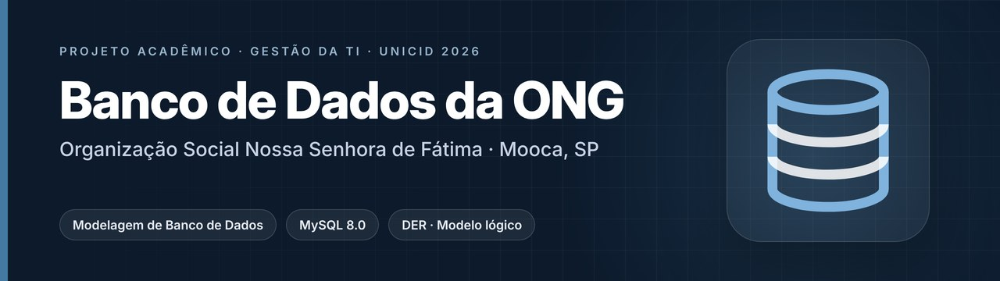
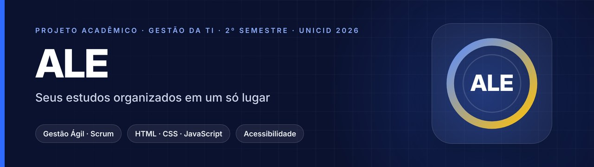
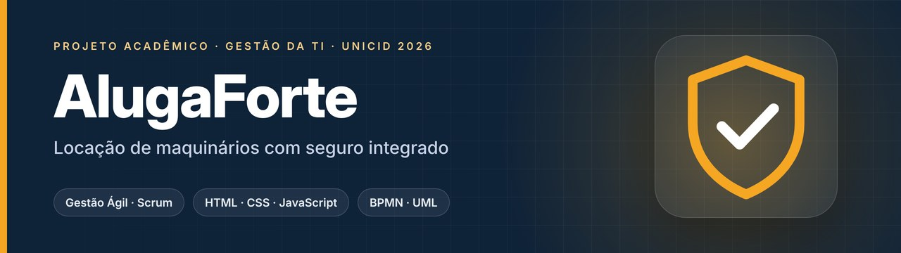
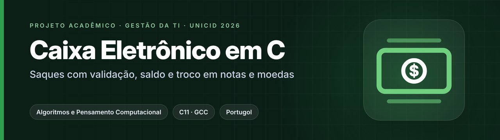

  

<h2 align="center">👨‍💻 <i>Sobre mim</i></h2>

Olá! Eu sou o **Henrique Novais de Oliveira**, estudante de **Gestão da Tecnologia da Informação** na **UNICID**. Há **4 anos** nas áreas **administrativa e de logística**, com vivência em rotinas operacionais e controle de processos. Meu objetivo é unir essa prática com a TI para atuar com **inovação, otimização de processos e governança**.

  🎓 <b><i>Estudando Gestão da TI na UNICID (2º semestre)</i></b> 
  💼 <b><i>Assistente administrativo na OM30</i></b> 
  📦 <b><i>4 anos em rotinas administrativas e de logística</i></b> 
  🏆 <b><i>Hackathon WECTI 2026 com a equipe do PEEK</i></b> 
  📍 <b><i>São Paulo, Brasil</i></b>

 

<h2 align="center">🛠️ <i>Tecnologias</i></h2>

 

<h2 align="center">📈 <i>Estatísticas</i></h2>

 

 

Atualizados todo dia por uma rotina do GitHub Actions neste repositório.

<h2 align="center">🎓 <i>Formação</i></h2>

| Curso | Instituição | Situação |
| :--- | :--- | :--- |
| Gestão da Tecnologia da Informação | UNICID – Universidade Cidade de São Paulo | Em andamento · 2º semestre (2026) |

**Disciplinas do semestre**

| Disciplina | Professor | Projeto |
| :--- | :--- | :--- |
| Algoritmos e Pensamento Computacional | Prof. Carlos Eduardo Weber | [Caixa Eletrônico em C](https://github.com/novaishenrique/projeto-caixa-eletronico) |
| Modelagem de Banco de Dados | Prof. Cid Rodrigues | [Banco de Dados da ONG](https://github.com/novaishenrique/projeto-banco-de-dados-ong) |
| Gestão Ágil | Prof. Alexandre Carrocine | [ALE](https://github.com/novaishenrique/projeto-ALE) · [AlugaForte](https://github.com/novaishenrique/projeto-AlugaForte) |
| Design Profissional | — | — |

<h2 align="center">💼 <i>Experiência</i></h2>

| Cargo | Empresa | Período |
| :--- | :--- | :--- |
| Assistente administrativo | OM30 | set/2025 – atual · meio período |
| Aprendiz | Adrel | mai/2024 – ago/2025 · meio período |
| Aprendiz | Kalunga S.A. | set/2022 – dez/2023 · meio período |

<h2 align="center">🚀 <i>Projetos acadêmicos</i></h2>

<table>
  <tr>
    <td width="50%"></td>
    <td width="50%"></td>
  </tr>
  <tr>
    <td width="50%"></td>
    <td width="50%"></td>
  </tr>
</table>

| Projeto | Disciplina | O que é | Tecnologias |
| :--- | :--- | :--- | :--- |
| [**Banco de Dados da ONG**](https://github.com/novaishenrique/projeto-banco-de-dados-ong) | Modelagem de Banco de Dados Prof. Cid Rodrigues · em grupo | Banco de dados para uma ONG real da Mooca: 19 tabelas, DER e modelo lógico, regras de negócio e LGPD, script testado a cada push | MySQL · GitHub Actions |
| [**ALE**](https://github.com/novaishenrique/projeto-ALE) | Gestão Ágil Prof. Alexandre Carrocine · em grupo | Organizador de entregas acadêmicas em dois sites, feito em 4 sprints de Scrum | HTML · CSS · JavaScript · Netlify |
| [**AlugaForte**](https://github.com/novaishenrique/projeto-AlugaForte) | Gestão Ágil Prof. Alexandre Carrocine · em grupo | Plataforma de locação de maquinários com seguro integrado, com UML, BPMN e backlog | HTML · CSS · JavaScript · Netlify |
| [**Caixa Eletrônico em C**](https://github.com/novaishenrique/projeto-caixa-eletronico) | Algoritmos e Pensamento Computacional Prof. Carlos Eduardo Weber | Saques com validação, saldo e troco em notas e moedas, com testes automáticos | C · GCC · Portugol |

**Evento:** Hackathon WECTI 2026 (UNICID), na equipe do **PEEK**, uma proposta de controle de estoque inteligente e omnichannel para pequenas e médias empresas do varejo.

<h2 align="center">🌱 <i>Aprendendo agora</i></h2>

- Modelagem conceitual e lógica (DER, normalização) e SQL no MySQL
- Gestão ágil: Scrum, backlog e sprints
- Governança de TI e otimização de processos
- Versionamento com Git: issues, branches, pull requests e GitHub Actions

<h2 align="center">📫 <i>Contato</i></h2>

[LinkedIn](https://www.linkedin.com/in/henrique-novais-de-oliveira-3398b640a/) · [@novaishenriquee](https://www.instagram.com/novaishenriquee/) · [henriqueisabella11@gmail.com](mailto:henriqueisabella11@gmail.com)

 

