 

  

Estudante do **2º semestre de Gestão da Tecnologia da Informação** na **UNICID** 🎓 · São Paulo, Brasil 📍 
Há **4 anos** nas áreas **administrativa e de logística** 📦, com vivência em rotinas operacionais e controle de processos. 
Meu objetivo é unir essa prática com a TI para atuar com **inovação, otimização de processos e governança** 🚀

---

<h2 align="center">🛠️ Tecnologias e métodos</h2>

<h2 align="center">📊 Minhas estatísticas no GitHub</h2>

 

Atualizados todo dia por uma rotina do GitHub Actions neste repositório.

---

## 🎓 Formação

| Curso | Instituição | Situação |
| :--- | :--- | :--- |
| Gestão da Tecnologia da Informação | UNICID – Universidade Cidade de São Paulo | Em andamento · 2º semestre (2026) |

**Disciplinas do semestre:** Algoritmos e Pensamento Computacional · Modelagem de Banco de Dados · Gestão Ágil · Design Profissional

## 💼 Experiência

| Cargo | Empresa | Período |
| :--- | :--- | :--- |
| Assistente administrativo | OM30 | set/2025 – atual · meio período |
| Aprendiz | Adrel | mai/2024 – ago/2025 · meio período |
| Aprendiz | Kalunga S.A. | set/2022 – dez/2023 · meio período |

## 🚀 Projetos acadêmicos

| Projeto | Contexto | O que é | Tecnologias |
| :--- | :--- | :--- | :--- |
| [**Banco de dados da ONG**](https://github.com/novaishenrique/projeto-banco-de-dados-ong) | Modelagem de Banco de Dados (em grupo) | Banco de dados para uma ONG real da Mooca: 19 tabelas, DER e modelo lógico, regras de negócio e LGPD, script testado a cada push | MySQL · GitHub Actions |
| [**ALE**](https://github.com/novaishenrique/projeto-ALE) | Atividade prática de Scrum (em grupo) | Organizador de entregas acadêmicas, desenvolvido em sprints | HTML · CSS · JavaScript · Netlify |
| [**AlugaForte**](https://github.com/novaishenrique/projeto-AlugaForte) | Gestão Ágil (em grupo) | Plataforma de locação de maquinários com seguro integrado | HTML · CSS · JavaScript · Netlify |
| [**Caixa Eletrônico em C**](https://github.com/novaishenrique/Caixa-Eletr-nico-C) | Algoritmos (projeto introdutório) | Saques com validação, saldo e troco em notas e moedas, com testes automáticos | C · GCC · Portugol |

**Evento:** Hackathon WECTI 2026 (UNICID), na equipe do **PEEK**, uma proposta de controle de estoque inteligente e omnichannel para pequenas e médias empresas do varejo.

## 🌱 Aprendendo agora

- Modelagem conceitual e lógica (DER, normalização) e SQL no MySQL
- Gestão ágil: Scrum, backlog e sprints
- Governança de TI e otimização de processos
- Versionamento com Git: issues, branches, pull requests e GitHub Actions

---

<h2>📫 Contato</h2>

[LinkedIn](https://www.linkedin.com/in/henrique-novais-de-oliveira-3398b640a/) · [@novaishenriquee](https://www.instagram.com/novaishenriquee/) · [henriqueisabella11@gmail.com](mailto:henriqueisabella11@gmail.com)

